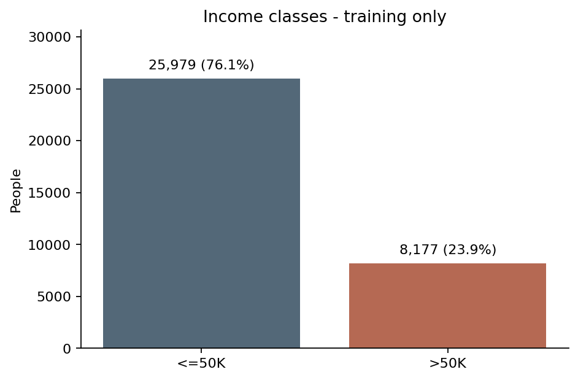
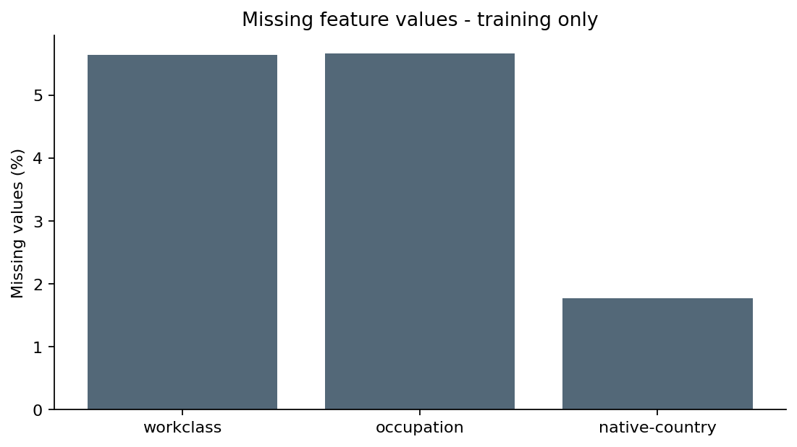
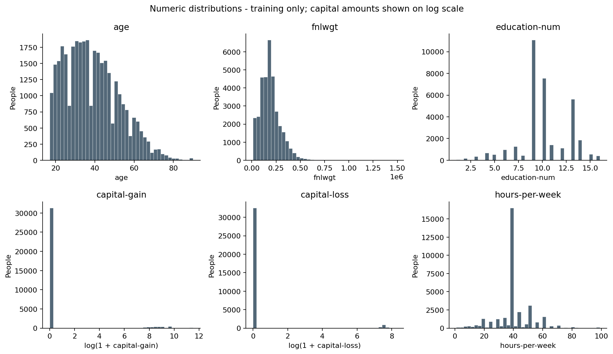
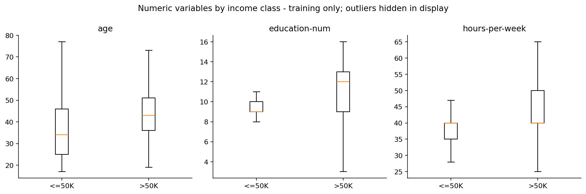
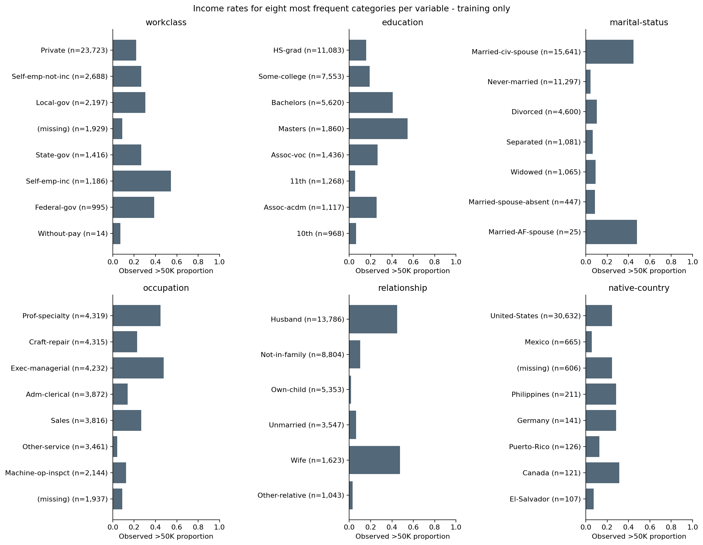
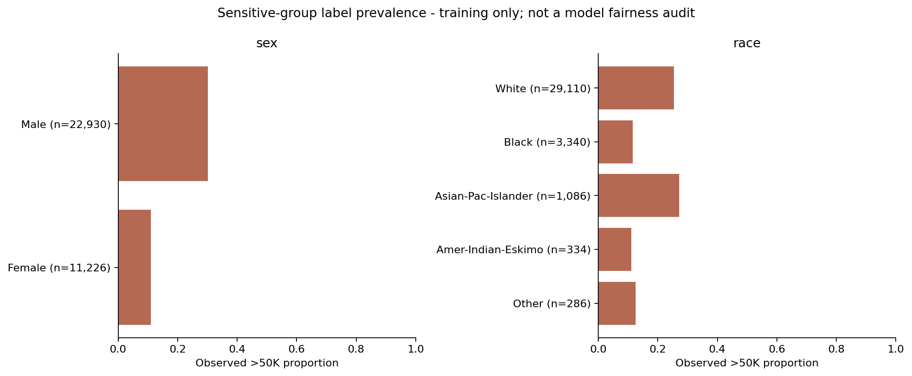
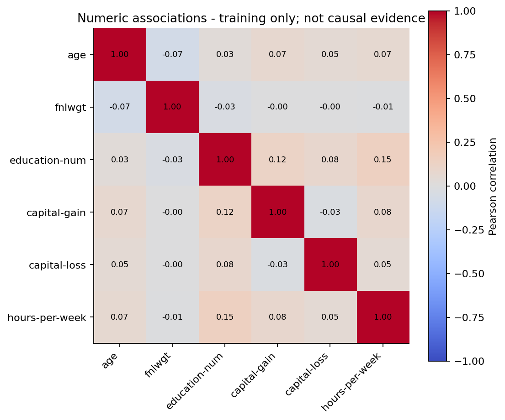

# Hugo's contribution - training EDA and data splitting

## Execution and scope

Executed from Python scripts using the repository's Excel snapshot. The framing is in [validation_protocol_addendum.md](../../docs/validation_protocol_addendum.md). This contribution adapts Jérémy's original EDA and adds splitting and integrity checks. The group's original files are preserved.

Raw rows: **48,842**. Exact repeats removed: **52**. Clean rows: **48,790**.

After exact deduplication, 10 rows in 5 groups share identical original predictors; 5 groups have contradictory labels. They are retained and each group is kept within one partition. We therefore use 20 stratified grouped folds: 14 training, 3 validation, 3 test. This gives approximately 70/15/15; folds are fixed by seed 42, not model performance.

| Partition | Rows | >50K count | >50K rate | Raw model predictors |
|---|---:|---:|---:|---:|
| train | 34,156 | 8,177 | 23.9402% | 11 |
| validation | 7,317 | 1,752 | 23.9442% | 11 |
| test | 7,317 | 1,752 | 23.9442% | 11 |

Checks passed: disjoint source rows and original predictor profiles, full coverage, aligned labels/sex and small stratification deviations. CSV SHA-256 hashes and runtime versions are recorded in the manifest; changed splits are not silently overwritten.

## Training-only findings

Training contains **34,156** people; **23.94%** are in >50K. Accuracy alone would reward majority prediction.

| Feature | Missing count | Missing rate |
|---|---:|---:|
| workclass | 1,929 | 5.65% |
| occupation | 1,937 | 5.67% |
| native-country | 606 | 1.77% |

Capital gain is zero for **91.81%** of training observations; capital loss is zero for **95.35%**. Evaluate justified log/indicator features within the training pipeline; plotting log values does not modify saved inputs.

Education labels map one-to-one to education-num in training. The initial protocol retains education-num. Exclude fnlwgt as a predictor under the chosen unweighted-sample protocol; keep sex separately for the planned fairness audit. This leaves 11 raw predictors, including race, before feature engineering.

| Sex group | Training rows | Observed >50K rate |
|---|---:|---:|
| Female | 11,226 | 11.07% |
| Male | 22,930 | 30.24% |

These are observed label prevalences, not model selection rates, recall gaps or evidence that a fitted model is fair. Other inputs can proxy sex. Rare categories have small sample sizes; preserve counts beside rates and fit any grouping on training only.

## Limitations and next steps

The original EDA inspected the full table before splitting; disclose this. These new charts and feature associations use training only. The held-out labels are used only for structural split checks at this stage. No fitted preprocessing, model comparison, Optuna tuning or model-based fairness result is claimed.

Values such as capital-gain=99999 may reflect coding conventions; their exact interpretation requires source verification. Identical profiles do not establish person identity, and survey-derived historical results need not generalize to other populations or periods. Predictive associations are not causal explanations.

Next implement a fitted preprocessing pipeline and 2-3 justified features; then compare models, address imbalance and tune on training CV. Calibrate/select thresholds and mitigation using validation, then evaluate frozen candidates on test. Transfer this section into the final LaTeX report with the contribution and AI-use disclosures.

## Figures

